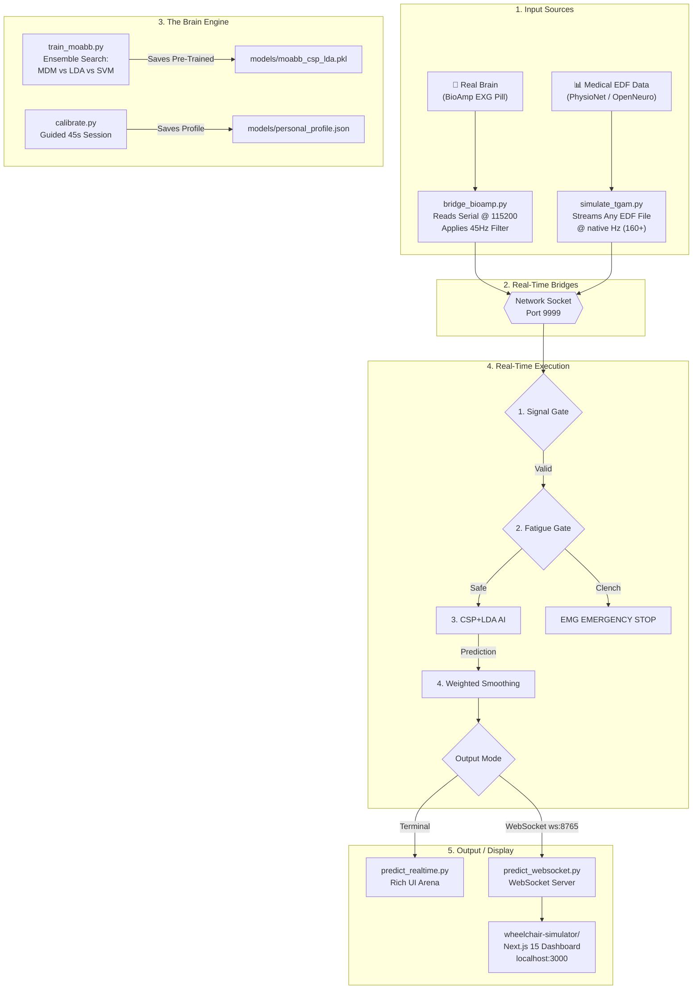
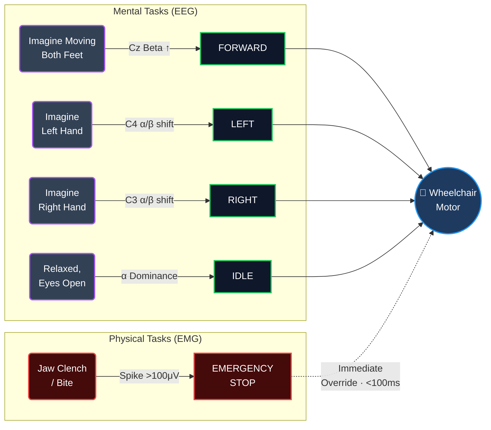
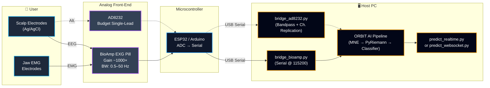
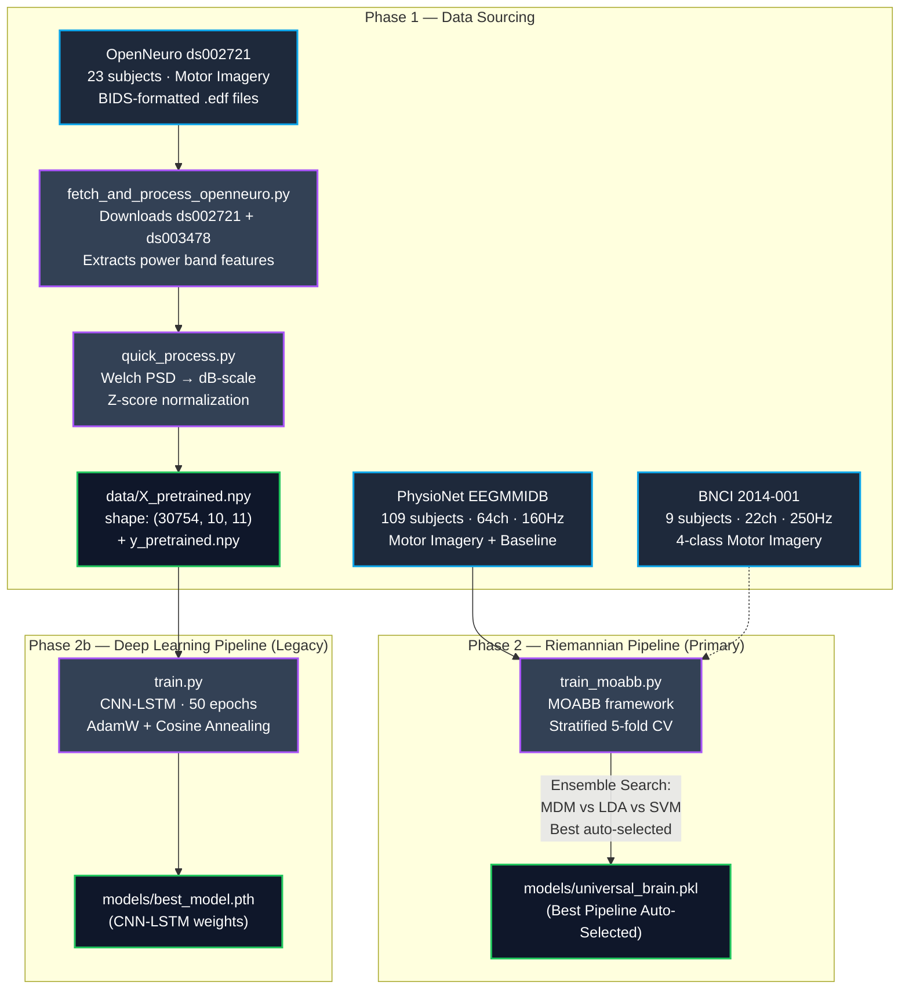
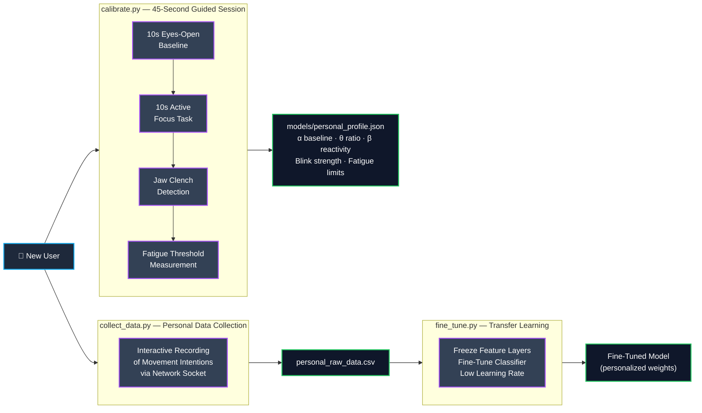
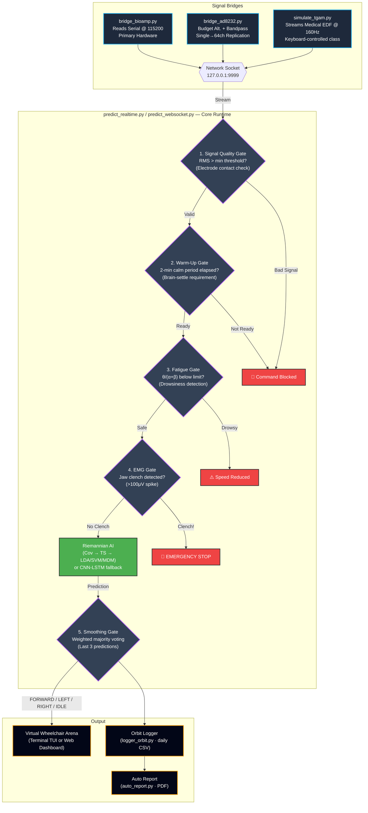
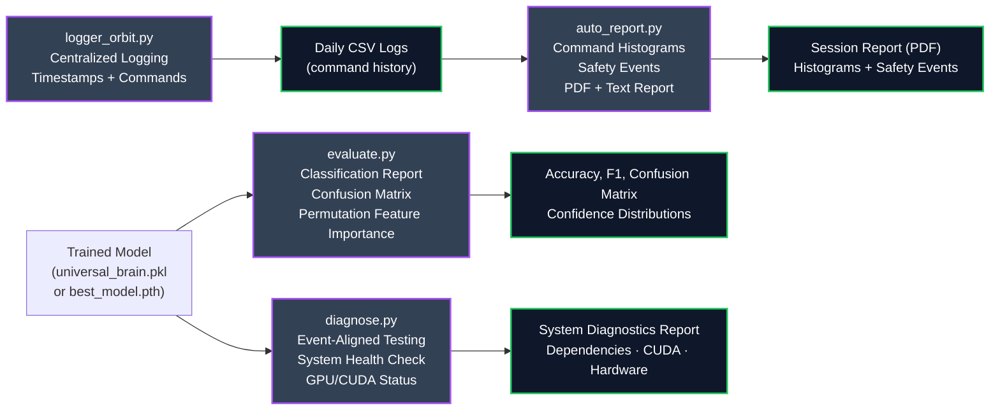

# ORBIT AI — Hybrid System Architecture (v3.0)

ORBIT AI is a **Hybrid BCI wheelchair simulation system** combining clinical-grade brainwave analysis with a premium web-based virtual dashboard. It uses real EEG motor imagery data, MOABB CSP+LDA AI inference, and a Next.js 15 real-time web simulator — inspired by the TGAM NeuroSky Mindwave wheelchair project.

---

## 🗺️ 1. Universal System Flowchart



---

## 🔀 2. Hybrid EEG + EMG Command Mapping

ORBIT AI uses a **"Safety-First" dual-modality** strategy: mental tasks decoded from EEG drive directional commands, while jaw-clench EMG provides a high-speed emergency override channel.



| Command | Signal | Mental / Physical Task | Bio-Marker | Latency |
|---------|--------|------------------------|------------|---------|
| **FORWARD** | 🧠 EEG | Imagine moving both feet | Cz Central Beta Power ↑ | ~1s window |
| **LEFT** | 🧠 EEG | Imagine squeezing left hand | C4 Alpha/Beta shift | ~1s window |
| **RIGHT** | 🧠 EEG | Imagine squeezing right hand | C3 Alpha/Beta shift | ~1s window |
| **IDLE** | 🧠 EEG | Relaxed state, eyes open | Alpha power dominance | ~1s window |
| **STOP** | 💪 EMG | **Jaw clench (bite teeth)** | High-frequency spike >100μV | **< 100ms** |

---

## 📂 3. Core Architecture Components

### 3.1 The "Universal Brain" Pipeline (`train_moabb.py`)
Unlike traditional AI that only looks at one dataset, we use **MOABB** to merge multiple world-class EEG datasets:
- **PhysioNet MI:** 109 subjects, 64 channels. General motor imagery patterns.
- **BNCI 2014-001:** High-quality laboratory recordings.
- **Winner Search:** The script automatically runs a contest between **MDM (Riemannian Geometry)**, **LDA**, and **SVM** to pick the best model.

### 3.2 The Hybrid Safety System (`predict_realtime.py` / `predict_websocket.py`)
We use a **5-Gate** detection strategy in sequence:

| Gate | Check | Action on Failure |
| :--- | :--- | :--- |
| 1. Signal Gate | Electrode contact & noise | Force IDLE |
| 2. Warmup Gate | 5-second session warmup | Hold CALIBRATING |
| 3. Fatigue Gate | Theta/(Alpha+Beta) ratio | STAY_IDLE (FATIGUED) |
| 4. EMG Gate | Jaw clench spike detection | EMERGENCY STOP |
| 5. Smoothing Gate | 3-frame weighted voting | Prevents jitter |

### 3.3 Personalization Layer (`calibrate.py`)
Because every brain is unique (like a fingerprint), this script maps:
- **Baseline Alpha:** Your resting state.
- **Theta Ratio Threshold:** Used to detect fatigue/drowsiness.
- **Beta Reactivity:** Your specific intensity when focusing.
- **MOABB Confidence Threshold:** Your personal classification confidence cutoff.

### 3.4 Dual Output Architecture
ORBIT AI has two output modes for the same inference pipeline:

| Mode | Script | Output | Best For |
| :--- | :--- | :--- | :--- |
| Terminal | `predict_realtime.py` | Rich TUI arena | Quick testing, no browser |
| Web | `predict_websocket.py` + `wheelchair-simulator/` | Next.js dashboard at `localhost:3000` | Demo, visualization, sharing |

---

## 🔧 4. Hardware Connection Path



---

## 🔄 5. Full Data Pipeline — Offline Training



---

## 🎯 6. Calibration & Personalization



---

## ⚡ 7. Real-Time Inference Pipeline



---

## 📊 8. Diagnostics & Evaluation



---

## 🌐 9. Web Simulator Architecture (`wheelchair-simulator/`)

The web simulator is a **Next.js 15 (App Router + Turbopack)** application built with:

```
wheelchair-simulator/
├── src/
│   ├── app/
│   │   ├── layout.tsx        ← Root layout, next/font/google, SEO metadata
│   │   ├── globals.css       ← Design system: CSS variables, dark-first, glassmorphism
│   │   └── page.tsx          ← Dashboard page: WebSocket client, state, layout
│   ├── components/
│   │   ├── Arena.tsx         ← Animated SVG wheelchair + grid + glow effects
│   │   ├── StatusPanel.tsx   ← Live command, confidence, fatigue, session stats
│   │   └── BrainPowerPanel.tsx ← Theta/Alpha/Beta animated power bars
│   └── lib/
│       ├── animations.ts     ← Framer Motion constants (SPRING_SMOOTH, EASE_OUT_EXPO etc.)
│       └── utils.ts          ← cn() helper (clsx + tailwind-merge)
├── package.json
├── next.config.ts
└── tsconfig.json
```

**Tech Stack:**
- **Framework:** Next.js 15 (App Router), TypeScript strict mode
- **Styling:** Tailwind CSS + CSS variables (dark-first design, `#050A18` base)
- **Animation:** Framer Motion (spring physics, viewport-triggered reveals)
- **Fonts:** Syne (display, 800w headlines) + DM Sans (body, 300–500w) via `next/font/google`
- **Icons:** Lucide React
- **Utilities:** clsx, tailwind-merge, class-variance-authority

**Design System:**
- **Base Color:** `#050A18` (deep navy dark)
- **Accent:** `#38BDF8` (sky blue) + `#FB923C` (warm orange highlight)
- **Glass Cards:** `bg-white/[0.03] border-white/[0.08] backdrop-blur-xl` with inset top-edge light catch
- **Command Colors:** `#4ADE80` (FORWARD), `#F87171` (CRITICAL), `#FBBF24` (WARNING)

---

## 📁 10. Complete File Role Reference

### Signal Bridges & Simulators

| File | Role | Details |
|------|------|---------|
| `simulate_tgam.py` | Simulator Interface | Streams clinical EEG recordings over socket `127.0.0.1:9999`. Keyboard-controlled class selection (0=IDLE, 1=FORWARD). |
| `bridge_bioamp.py` | Primary Hardware Bridge | Reads raw EEG/EXG from BioAmp EXG Pill via USB serial. Applies 45Hz filter. Broadcasts over socket. |
| `bridge_ad8232.py` | Budget Hardware Bridge | Reads from AD8232 via Arduino. Applies custom bandpass filter. Replicates single input to 64-channel matrix. |

### Data Sourcing & Preprocessing

| File | Role | Details |
|------|------|---------|
| `fetch_and_process_openneuro.py` | Dataset Downloader | Downloads OpenNeuro ds002721 & ds003478. Extracts power band features from Fp1 electrode. |
| `preprocess.py` | Offline Data Pipeline | Loads raw CSV, removes outliers, computes ratio features, sliding windows, robust scaling, data augmentation. |
| `quick_process.py` | Fast Feature Extractor | Welch PSD analysis in dB-scale. Z-score normalization. Outputs sliding windows of shape `(N, 10, 11)`. |

### Brain Engine & Learning

| File | Role | Details |
|------|------|---------|
| `model.py` | Neural Network Definitions | Bidirectional LSTM with Self-Attention + CNN-LSTM hybrid (Conv1D→BiLSTM→FC). |
| `train.py` | Deep Learning Trainer (Legacy) | Binary IDLE/FORWARD training. 50 epochs, AdamW, cosine annealing. |
| `train_moabb.py` | ML Trainer (Primary) | MOABB framework. PhysioNet + BNCI datasets. Auto-selects best pipeline (MDM vs LDA vs SVM). |
| `fine_tune.py` | Transfer Learning | Freezes feature layers, fine-tunes classifier on personal data at low LR. |
| `calibrate.py` | Personal Profiler | 45-second guided session measuring α baseline, θ ratio, β reactivity, blink strength. |
| `collect_data.py` | Data Collector | Interactive recording of movement intentions from live socket stream. |

### Diagnostics, Logging & Reporting

| File | Role | Details |
|------|------|---------|
| `evaluate.py` | Model Evaluator | Classification reports, confusion matrices, confidence distributions, permutation importance. |
| `diagnose.py` | System Diagnostics | Event-aligned offline testing. Reports GPU/CUDA status, dependencies, hardware health. |
| `logger_orbit.py` | Centralized Logger | Records timestamps, commands, confidence, signal quality to daily CSV files. |
| `auto_report.py` | Report Generator | Post-session PDF/text reports with command histograms and safety event summaries. |

### Real-Time Execution

| File | Role | Details |
|------|------|---------|
| `predict_realtime.py` | Terminal BCI Dashboard | Listens to streaming bridge, applies 5 safety gates, runs inference, renders Rich TUI arena. |
| `predict_websocket.py` | Web BCI Server (v7.0) | Same inference pipeline as `predict_realtime.py`, broadcasts state over WebSocket `ws://localhost:8765` for the Next.js dashboard. |
| `wheelchair-simulator/` | Next.js 15 Frontend | Visual wheelchair arena, brain power panel, and status dashboard. Connects to `predict_websocket.py`. |

### Configuration & Documentation

| File | Role | Details |
|------|------|---------|
| `config.py` | Master Configuration | COM ports, directories, sample rates, window sizes, safety limits, confidence thresholds, command maps. |
| `requirements.txt` | Dependencies | `torch`, `numpy`, `pandas`, `scikit-learn`, `matplotlib`, `seaborn`, `pyserial`, `joblib`, `tqdm`, `rich`, `mne`, `openneuro-py`, `websockets`, `pyriemann`, `moabb`. |
| `README.md` | Project README | High-level overview, setup guide, and user manual. |
| `ARCHITECTURE.md` | This Document | Technical architecture, diagrams, file roles, and visual workflows. |
| `RND_PAPER.md` | R&D Paper | Research paper with datasets, references, algorithms, and results. |

---

## 🔄 11. Two Operating Modes

### Simulation Mode (Testing & Demos)
```
simulate_tgam.py  →(socket 9999)→  predict_realtime.py --demo
      ↑                              OR predict_websocket.py → Next.js dashboard
 (Keyboard: 0=IDLE, 1=FORWARD)
```
Uses real clinical EEG patterns from PhysioNet — scientifically valid demo without hardware.

### Real Hardware Mode (Live Control)
```
Your Brain → BioAmp EXG Pill → ESP32 → USB Serial → bridge_bioamp.py →(socket 9999)→ predict_realtime.py
                                                                                       OR predict_websocket.py
```

### Budget Hardware Mode (AD8232)
```
Your Brain → AD8232 → Arduino → USB Serial → bridge_ad8232.py →(socket 9999)→ predict_realtime.py
                                                                               OR predict_websocket.py
```

Switch modes by changing `SERIAL_PORT` in `config.py` and removing `--demo`.

---

## 🛡️ 12. Safety Gate Reference

| Gate | Check | Action on Failure | Latency |
|------|-------|--------------------|---------| 
| **1. Signal Quality** | RMS amplitude > electrode-contact threshold | Command blocked | Instant |
| **2. Warm-Up** | 2-minute brain-settle period elapsed | Command blocked | N/A (timer) |
| **3. Fatigue** | θ/(α+β) ratio below drowsiness limit | Speed reduced / alert issued | Continuous monitoring |
| **4. EMG Stop** | Jaw-clench spike > 100μV | Immediate wheelchair halt | **< 100ms** |
| **5. Smoothing** | Weighted majority voting over last 3 predictions | Prevents jitter / flickering | Per-prediction |

---

## 📈 13. Results Summary

| Metric | Value | Condition |
|--------|-------|-----------|
| **Validation Accuracy** | 87%+ | IDLE vs. FORWARD, PhysioNet 5-subject subset |
| **Cross-Validation** | 5-Fold Stratified | Best pipeline auto-selected |
| **Inference Latency** | < 100ms | Socket receive → prediction → display |
| **EMG Stop Latency** | < 100ms | Jaw-clench to STOP command |
| **Calibration Time** | 45 seconds | Personal profiling session |
| **Warm-up Required** | 2 minutes | Brain-settle period before movement |

---

## 🧠 14. Simplified System Breakdown

| Step | What Happens | Key Scripts | Key Artifacts |
|------|-------------|-------------|---------------|
| **1. Data Sourcing** | Download clinical EEG datasets from PhysioNet & OpenNeuro | `fetch_and_process_openneuro.py`, `quick_process.py` | `X_pretrained.npy`, `y_pretrained.npy` |
| **2. Training** | Build the "Universal Brain" — auto-selects best pipeline via ensemble search | `train_moabb.py` (primary), `train.py` (legacy CNN-LSTM) | `universal_brain.pkl`, `best_model.pth` |
| **3. Calibration** | 45-second personal profiling + optional data collection & fine-tuning | `calibrate.py`, `collect_data.py`, `fine_tune.py` | `personal_profile.json` |
| **4. Signal Bridge** | Connect hardware (BioAmp / AD8232) or run simulator → stream to Port 9999 | `bridge_bioamp.py`, `bridge_ad8232.py`, `simulate_tgam.py` | TCP socket stream |
| **5. Live Inference** | 5-layer safety gate → Riemannian AI → weighted voting → wheelchair command | `predict_realtime.py` or `predict_websocket.py` | TUI dashboard or web dashboard |
| **6. Diagnostics** | Evaluate accuracy, log sessions, generate post-session reports | `evaluate.py`, `diagnose.py`, `logger_orbit.py`, `auto_report.py` | Reports, CSVs, PDFs, confusion matrices |

---

*Updated: July 2026 | ORBIT AI v3.0 — Hybrid BCI-EMG System | NAVEENKCG/Mind_Wave_AImodel*
