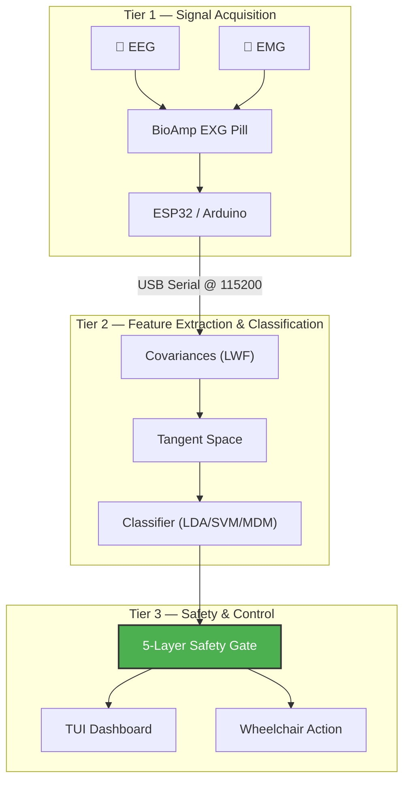

# 🧠 ORBIT AI — Universal BCI System (v2.0)


**ORBIT AI** is a state-of-the-art, open-source **Brain-Computer Interface** designed for medical wheelchair control. It uses a **Hybrid BCI-EMG** architecture that fuses clinical-grade neural decoding (EEG) with high-speed muscle signal detection (EMG) for maximum safety and reliability.

> **83.71% accuracy** on IDLE vs. FORWARD classification using 21-channel FBCSP+LDA pipeline with corrected cross-validation · **< 100ms** emergency stop via jaw-clench EMG detection · **95-second** comprehensive personal calibration

---

## 📐 Hybrid Command Mapping

We use a **"Safety-First"** dual-modality strategy — mental tasks for direction, jaw clench for instant stop:

| Command | Signal | Mental / Physical Task | Brain Bio-Marker |
| :--- | :--- | :--- | :--- |
| **FORWARD** | 🧠 EEG | Imagine moving both feet | Cz Central Beta Power ↑ |
| **LEFT** | 🧠 EEG | Imagine squeezing left hand | C4 Alpha/Beta shift |
| **RIGHT** | 🧠 EEG | Imagine squeezing right hand | C3 Alpha/Beta shift |
| **IDLE** | 🧠 EEG | Relaxed state, eyes open | Alpha power dominance |
| **STOP** | 💪 EMG | **Jaw clench (bite teeth)** | High-frequency spike >100μV |

---

## 📋 Prerequisites

- Python 3.10+
- Node.js 18+ and npm (only required for the web dashboard)
- For real hardware mode: BioAmp EXG Pill connected via USB, 
  update SERIAL_PORT in config.py

---

## ⚡ Quick Start (Demo in 2 commands)

Terminal 1:
```bash
python simulate_tgam.py
```

Terminal 2:
```bash
python predict_realtime.py --demo
```

OR one command:
```bash
python demo_mode.py
```

---

## 🛠️ Technology Stack

| Layer | Technology |
|-------|-----------|
| **Hardware** | BioAmp EXG Pill (Gain ~1000×) / AD8232 (budget alt.) + ESP32/Arduino |
| **Signal Processing** | Stateful zero-phase sosfilt (1–45 Hz) + SciPy (Welch PSD) |
| **AI Core — Primary** | MOABB + PyRiemann (Covariances → Tangent Space → LDA/SVM/MDM) |
| **AI Core — Legacy** | PyTorch CNN-LSTM (Conv1D → BiLSTM → FC) |
| **Safety** | 5-Layer Gate Pipeline (Signal Quality · Warm-Up · Fatigue · EMG Stop · Voting) |
| **Interface** | Real-time TUI dashboard with Python `Rich` |
| **Diagnostics** | Session logging (100ms telemetry), auto-generated PDF reports |

---

## 🗺️ System Architecture



> 📄 For detailed architecture diagrams and data pipeline flowcharts, see [visual_workflow.md](./visual_workflow.md)
>
> 📄 For the full research paper with references, see [RND_PAPER.md](./RND_PAPER.md)

---

## 🚀 Getting Started

### 1. Installation

```bash
pip install -r requirements.txt
```

For the web dashboard, also install Node.js dependencies:
```bash
cd wheelchair-simulator
npm install
cd ..
```

### 2. The "Universal Brain" Training

```bash
python train_moabb.py
```

### 3. Personal Calibration

IMPORTANT: This requires simulate_tgam.py running in a 
separate terminal first (see Step 4a below), since 
calibrate.py connects to it via socket on port 9999.

Terminal 1:
```bash
python simulate_tgam.py
```

Terminal 2 (after Terminal 1 is running):
```bash
python calibrate.py
```

### 4. Real-time Control — Two Interface Options

Choose ONE of the following based on your needs:

#### Option A — Terminal Dashboard (fastest, for quick testing and debugging)

Terminal 1:
```bash
python simulate_tgam.py
```

Terminal 2:
```bash
python predict_realtime.py --demo
```

#### Option B — Full Web Dashboard (recommended for demos and presentations)

Terminal 1:
```bash
python simulate_tgam.py
```

Terminal 2:
```bash
python predict_websocket.py
```

Terminal 3:
```bash
cd wheelchair-simulator
npm run dev
```

Then open http://localhost:3000 in your browser to see the 
live wheelchair arena, brain power panel, and status dashboard.

#### For Real Hardware (instead of simulate_tgam.py)

Terminal 1:
```bash
python bridge_bioamp.py
```

Terminal 2:
```bash
python predict_realtime.py
# (or python predict_websocket.py for the web dashboard)
```

---

## 🛡️ 5-Layer Safety Pipeline

The `predict_realtime.py` engine implements sequential security checks before any wheelchair command is issued:

| Gate | Check | Action on Failure |
|------|-------|-------------------|
| **1. Signal Quality** | RMS amplitude > electrode-contact threshold | Command blocked |
| **2. Warm-Up** | 2-minute "Brain-Settle" period elapsed | Command blocked |
| **3. Fatigue Monitor** | θ/(α+β) ratio below drowsiness limit | Speed reduced / alert |
| **4. EMG Emergency Stop** | Jaw clench spike > 100μV | Immediate halt (< 100ms) |
| **5. Weighted Voting** | Majority vote over last 3 predictions | Prevents jitter/flickering |

---

## 📊 Results

### Current System Results
| Metric | Value | Condition |
|--------|-------|-----------|
| **Validation Accuracy** | 83.71% | IDLE vs. FORWARD, 21-channel FBCSP+LDA (data leakage resolved & artifact rejection) |
| **Cross-Validation** | 5-Fold Stratified | Best pipeline auto-selected |
| **Inference Latency** | < 100ms | Socket → prediction → display |
| **EMG Stop Latency** | < 100ms | Jaw-clench → STOP command |
| **Calibration Time** | 95 seconds | Personal profiling session (includes L/R imagery) |

### Overall Project Benchmarks
| Metric | Value |
|--------|-------|
| Model | MOABB FBCSP+LDA |
| Cross-validation Accuracy | 83.71% (PhysioNet Motor Imagery) |
| Inference Latency | < 1 second |
| Training Subjects | 9+ clinical EEG subjects |
| Emergency Stop Response | < 100ms (jaw clench EMG) |
| Prototype Cost | ~₹5,000 |

---

## 📁 File Structure

orbit-ai/
├── predict_realtime.py   ← Main dashboard
├── simulate_tgam.py      ← EEG stream simulator
├── train_moabb.py        ← Universal brain training
├── calibrate.py          ← Personal calibration
├── diagnose.py           ← System health check
├── bridge_bioamp.py      ← Real hardware bridge
├── bridge_ad8232.py      ← AD8232 EMG bridge
├── logger_orbit.py       ← Session logging
├── config.py             ← All settings
├── model.py              ← CNN-LSTM architecture
└── models/
    ├── moabb_csp_lda.pkl ← Trained MOABB model
    └── personal_profile.json ← Your calibration

---

## 📁 Project Structure

```
Mind_Wave_AImodel/
├── config.py                       # Master configuration (ports, thresholds, paths)
├── requirements.txt                # Python dependencies
│
├── # ── Signal Bridges ────────────────────────────
├── bridge_bioamp.py                # Primary hardware bridge (BioAmp EXG Pill)
├── bridge_ad8232.py                # Budget hardware bridge (AD8232)
├── simulate_tgam.py                # EEG simulator (streams clinical data over socket)
│
├── # ── Data Pipeline ─────────────────────────────
├── fetch_and_process_openneuro.py  # Downloads OpenNeuro datasets
├── quick_process.py                # Welch PSD feature extraction
├── preprocess.py                   # Full offline preprocessing pipeline
│
├── # ── AI Engine ─────────────────────────────────
├── model.py                        # CNN-LSTM neural network architecture
├── train.py                        # Deep learning trainer (legacy)
├── train_moabb.py                  # Riemannian pipeline trainer (primary)
├── calibrate.py                    # 95-second personal profiler
├── collect_data.py                 # Personal data collection
├── fine_tune.py                    # Transfer learning fine-tuning
│
├── # ── Runtime ───────────────────────────────────
├── predict_realtime.py             # Core runtime + TUI dashboard
│
├── # ── Diagnostics & Reporting ───────────────────
├── evaluate.py                     # Model evaluation (accuracy, F1, confusion matrix)
├── diagnose.py                     # System health check + event-aligned testing
├── logger_orbit.py                 # Centralized daily logging
├── auto_report.py                  # Post-session PDF/text report generator
│
├── # ── Documentation ─────────────────────────────
├── README.md                       # This file
├── ARCHITECTURE.md                 # Architecture deep-dive
├── orbit_ai_architecture.md        # Full architecture manual
├── visual_workflow.md              # Mermaid flowcharts & data pipeline diagrams
├── FILE_ROLES.md                   # File-by-file role reference
├── RND_PAPER.md                    # Full R&D paper with references
│
├── data/                           # Training data (.npy, .csv, .edf)
├── models/                         # Saved models (.pkl, .pth, .json)
└── notebooks/                      # Jupyter notebooks
```

---

## ⚠️ Troubleshooting

**ImportError: No module named 'logger_orbit'**
Ensure logger_orbit.py exists in the project root. Run 
git pull to fetch the latest version if missing.

**Connection refused on port 9999**
Start simulate_tgam.py FIRST, in its own terminal, before 
running calibrate.py, predict_realtime.py, or predict_websocket.py.

**Web dashboard shows blank page / won't connect**
1. Confirm predict_websocket.py is running and shows 
   "WebSocket server started" in the terminal
2. Confirm you ran npm install inside wheelchair-simulator/ 
   at least once
3. Check the browser console for WebSocket connection errors

**All predictions show IDLE**
Run python calibrate.py to set your personal bio-thresholds 
before running predict_realtime.py or predict_websocket.py.

**ModuleNotFoundError for moabb or pyriemann**
These are required by train_moabb.py. Run:
  pip install moabb pyriemann

---

## 📚 Documentation

| Document | Description |
|----------|-------------|
| [ARCHITECTURE.md](./ARCHITECTURE.md) | Full system architecture, file roles, and visual workflows |
| [RND_PAPER.md](./RND_PAPER.md) | Research paper with datasets, algorithms, and 23 academic references |

---

## 🔬 Datasets

| Dataset | Subjects | Channels | Rate | Usage |
|---------|----------|----------|------|-------|
| [PhysioNet EEGMMIDB](https://physionet.org/content/eegmmidb/1.0.0/) | 109 | 64 | 160 Hz | Primary training (Riemannian pipeline) |
| [OpenNeuro ds002721](https://openneuro.org/datasets/ds002721) | 23 | Variable | Variable | Legacy CNN-LSTM pre-training |
| [BNCI 2014-001](http://bnci-horizon-2020.eu/database/data-sets#001-2014) | 9 | 22 | 250 Hz | Validation & benchmarking |

---

## ⚠️ Safety Notice

> **ORBIT AI is a research prototype.** It has **not** been certified by any medical device regulatory authority (e.g., FDA, CE). Do not use as the sole control mechanism for a powered wheelchair without additional mechanical safety systems (e.g., bump sensors, dead-man switch).

---

## 🤝 Acknowledgements

Built upon the open-source BCI community: [PhysioNet](https://physionet.org) · [MNE-Python](https://mne.tools) · [MOABB](https://moabb.neurotechx.com) · [PyRiemann](https://pyriemann.readthedocs.io) · [Upside Down Labs](https://upsidedownlabs.tech) · [NeuroTechX](https://neurotechx.com)

---

*ORBIT AI v2.0 · June 2026 · NAVEENKCG/Mind_Wave_AImodel*
